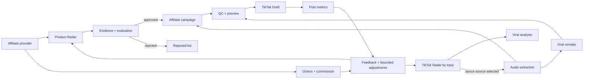

# System blueprint — TikTok core flows

## Phạm vi

Hai flow hiện hành: TikTok affiliate và TikTok viral. Truyện audio ở phase sau.

## Luồng dữ liệu

## Thành phần

| Thành phần | Trách nhiệm |
|---|---|
| `internal/accesstrade` | Campaign, offer, affiliate link, order/commission sync khi provider hỗ trợ |
| `internal/products` | Candidate snapshots, category/rule evaluation, approved/rejected state, product usage |
| `internal/studio` | Affiliate/viral plan, media generation, Radar audio extraction, QC, job/artifact provenance |
| `internal/growth` | TikTok video snapshots, account baselines, funnel analysis, recommendations and rollback history |
| `internal/tiktok` + `internal/publishers` | TikTok OAuth, upload draft, provider state/reconciliation |
| `internal/web` | Go templates, HTMX partials, operator review and controls |
| `internal/ledger` | Accounts, characters, decisions, audit records and shared settings |

## Data contracts

- Product candidate: provider + provider product ID + category + price/currency + commission + source timestamp + snapshot ID.
- Evaluation: candidate snapshot + rule version + facts + unknowns + verdict + reason + confidence + actor + time.
- TikTok Radar video: provider + video ID/URL + author + topic + collected-at + metrics snapshot + audio metadata + dance classification state.
- Campaign/job: flow + account + product if affiliate + selected Radar source + audio source + provider + artifact/QC + draft/publish state.
- Performance: account/video ID + metric name/value + provider + timestamp + window + attribution scope.
- Recommendation: evidence IDs + sample size + confidence + proposed setting diff + rule version + apply/rollback audit.

Unknown values stay null/unknown. Old snapshots remain immutable. Repeated syncs use provider IDs/idempotency keys.

## Automation boundaries

- Scheduled Radar/search and metric sync may run automatically under operator-configured limits.
- Product verdict may auto-approve only after hard gates, freshness and configured confidence pass; otherwise `needs_review`.
- Rejected products remain inspectable and re-evaluable.
- Studio generation may proceed only from approved product or selected TikTok Radar source.
- Public publish/product attachment must reflect a verified TikTok result. Until then use Draft and expose remaining manual steps.
- Setting auto-adjustment is bounded, reversible and versioned. Offer choice, claims, publish rights, account permissions and provider budgets require operator approval.
- Preserve data in existing SQLite databases. Remove unused code and new-schema declarations without dropping existing user tables or rows.

## UI architecture

- Go `html/template` owns first render and page/partial HTML.
- HTMX sends form and action requests and swaps server-rendered partials.
- Tailwind CSS source is pinned and compiled to local static CSS during build; production does not depend on CDN.
- Stable URL per screen; HTMX history enabled only where page state is reconstructible.
- Errors render near the triggering action with source/provider and retry state; no optimistic success for provider actions.

## External capability gaps

Current repo has AccessTrade offers, links and orders; per-product sales/rating and TikTok video attribution are not proven. TikTok Radar collects a Vietnam feed via TikWM when no topic is set; a topic query calls TikWM `feed/search` directly. It stores at most 2,000 recent video records and 30 days of metric snapshots in SQLite, ranks by view velocity when two valid observations exist, and otherwise by current views. The external topic-search endpoint and feed freshness still need live verification; dance classification stays operator-confirmed. It accepts only TikTok URLs with matching provider video IDs. TikTok Display API code reads follower/video totals and current public-video counters when scopes are granted; retention, watch-time, demographics and Shop product attachment are not proven end-to-end. Keep each unsupported field `unknown` and gate related automation.
