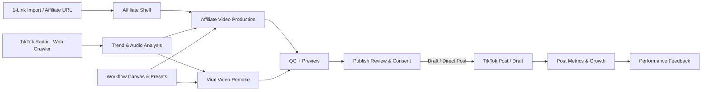

# System blueprint — TikTok core flows

## Phạm vi

Hai flow hiện hành: TikTok affiliate và TikTok viral. Truyện audio ở phase sau.

## Luồng dữ liệu

## Thành phần

| Thành phần | Trách nhiệm |
|---|---|
| `internal/products` | Quản lý sản phẩm kệ hàng, bóc tách link affiliate, lưu trữ ảnh & giá |
| `internal/studio` | Affiliate/viral plan, media generation, Radar audio extraction, QC, job/artifact provenance |
| `internal/growth` | TikTok video snapshots, account baselines, funnel analysis, recommendations and rollback history |
| `internal/tiktok` + `internal/publishers` | TikTok OAuth, draft/direct-post adapters, Shop shoppable-video adapter, provider state/reconciliation |
| `internal/web` | Go templates, HTMX partials, operator review and controls |
| `internal/ledger` | Accounts, characters, decisions, audit records and shared settings |

## Data contracts

- Product candidate: offer provider + offer/product ID + optional TikTok Shop product ID + verified mapping state + category + price/currency + commission + source timestamp + snapshot ID.
- Evaluation: candidate snapshot + rule version + facts + unknowns + verdict + reason + confidence + actor + time.
- TikTok Radar video: Web Crawler source + video ID/URL + author + topic + collected-at + metrics snapshot + audio metadata + manual dance review state. Crawler contract in [TikTok Web Crawler](features/tiktok-web-crawler.md).
- Campaign/job: flow + account + approved offer ID + TikTok Shop product/anchor IDs and state if affiliate + selected Radar source + audio source + provider + artifact/QC + consent evidence + draft/publish state.
- Performance: account/video ID + metric name/value + provider + timestamp + window + attribution scope.
- Recommendation: evidence IDs + sample size + confidence + proposed setting diff + rule version + apply/rollback audit.

Unknown values stay null/unknown. Old snapshots remain immutable. Repeated syncs use provider IDs/idempotency keys.

## Automation boundaries

- Radar/search và đồng bộ metric thực thi on-demand theo lệnh của operator; không có daemon hay worker chạy ngầm tự động khi khởi động.
- Product verdict may auto-approve only after hard gates, freshness and configured confidence pass; otherwise `needs_review`.
- Rejected products remain inspectable and re-evaluable.
- Studio generation may proceed only from approved product or selected TikTok Radar source.
- Every TikTok submission requires a review screen, correct account display, explicit per-post consent and truthful provider state. Direct Post public mode requires approved scopes/audit and permitted app use; MiuNova's internal-tool use must not assume eligibility. Shoppable affiliate publish requires TikTok Shop partner/creator authorization and a confirmed product anchor. Otherwise use Draft/manual handoff.
- Keep `upload/draft`, `publishing`, `public`, `failed`, and `reconcile_required` distinct. A successful upload response alone does not prove public post or attached product.
- Setting auto-adjustment is bounded, reversible and versioned. Offer choice, claims, publish rights, account permissions and provider budgets require operator approval.
- Preserve data in existing SQLite databases. Remove unused code and new-schema declarations without dropping existing user tables or rows.

## UI architecture

- Go `html/template` owns first render and page/partial HTML.
- HTMX sends form and action requests and swaps server-rendered partials.
- Tailwind CSS source is pinned and compiled to local static CSS during build; production does not depend on CDN.
- Stable URL per screen; HTMX history enabled only where page state is reconstructible.
- Errors render near the triggering action with source/provider and retry state; no optimistic success for provider actions.

## External capability gaps

Current repo has AccessTrade offers, links and orders; per-product sales/rating and TikTok video attribution are not proven. Radar implementation, unknown-field behavior, manual dance review, local-browser dependency and production permission status are documented in [TikTok Web Crawler](features/tiktok-web-crawler.md). TikTok Display API is separate and reads public-video counters after publish when scopes are granted; retention, watch-time, demographics and Shop product attachment are not proven end-to-end. TikTok Content Posting API supports draft upload; Direct Post and TikTok Shop product anchors remain unverified. Keep unsupported fields `unknown` and gate related automation.
