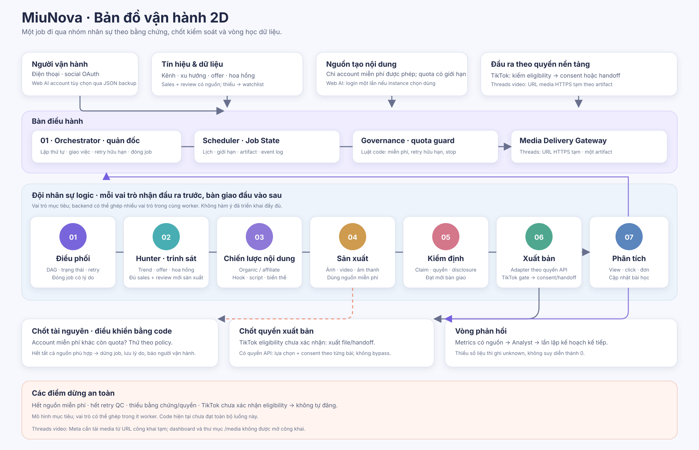
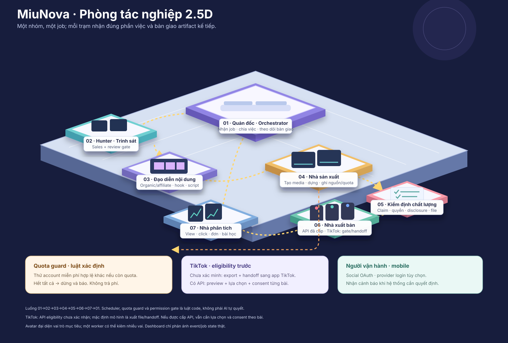
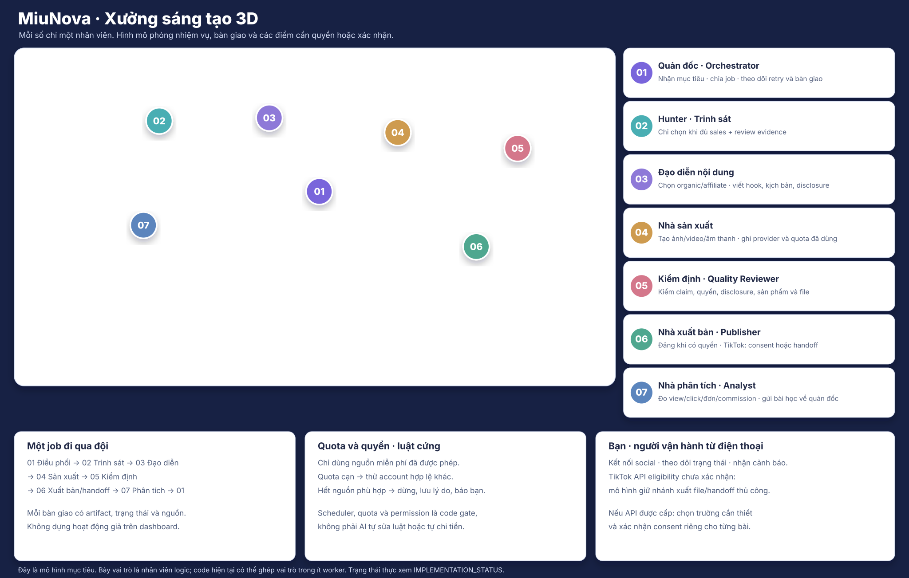
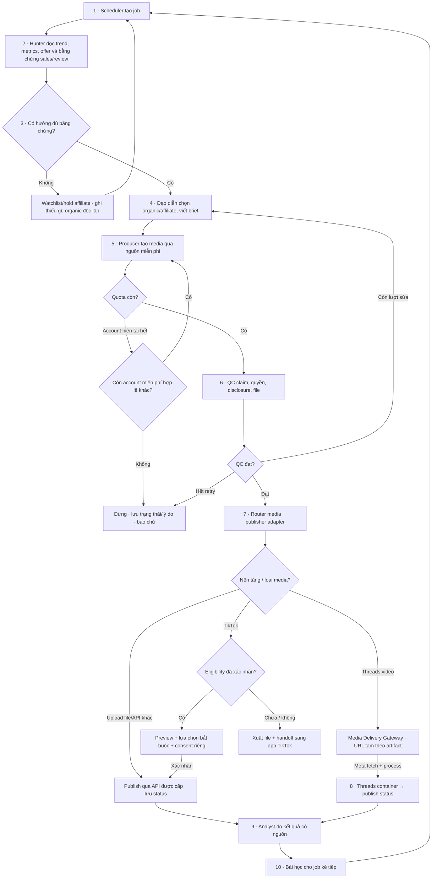

# SYSTEM_BLUEPRINT — Mô hình hệ thống

> **Đây là mô hình mục tiêu sau khi hoàn thành.** Bảy “nhân viên” là vai trò
> logic trong luồng công việc; chúng có thể được thực thi bởi ít worker hơn,
> không hàm ý có bảy tiến trình AI độc lập. Bộ điều khiển quota, quyền đăng và
> chính sách là luật xác định bằng code, không phải quyết định của LLM.
>
> Trạng thái code thật: [IMPLEMENTATION_STATUS](IMPLEMENTATION_STATUS.md).
> Đặc tả mục tiêu: [PRODUCT_SPEC](PRODUCT_SPEC.md). Quyết định và giả định:
> [PRODUCT_DECISIONS](PRODUCT_DECISIONS.md). Tên hiển thị là **MiuNova**; tên
> module/repository kỹ thuật vẫn là `ai-creator-os` để giữ tương thích.

## Tên và linh vật

**MiuNova** là tên thương hiệu đã chốt. “Miu” gợi mèo; “Nova” gợi không gian.
Logo và các sơ đồ dùng chung mascot mèo với điểm nhấn quỹ đạo/ngôi sao.

## Ba góc nhìn hệ thống

Ba hình dùng cùng số thứ tự 01–07 để nối nhân viên với công việc. 2D cho thấy
luồng dữ liệu và quyền; 2.5D cho thấy từng bàn làm việc; 3D đặt vai trò vào
xưởng mô phỏng. Đây là vai trò logic, không khẳng định có bảy tiến trình AI.

### 2D · kiến trúc và luồng quyền

```mermaid
flowchart LR
    OWNER["Người vận hành<br/>điện thoại"] -->|HTTPS / OAuth| WEB["Web app mobile-first"]
    WEB <--> STATE[("Job state · event log · artifacts")]
    SCHED["Scheduler"] --> ORCH["Orchestrator"]
    ORCH <--> STATE
    SIGNAL["Kênh · trend · offer · evidence nguồn"] --> SCOUT["Hunter · Trinh sát"]
    SCOUT --> DIRECTOR["Chiến lược nội dung"]
    DIRECTOR --> PRODUCER["Sản xuất"]
    PRODUCER --> ROUTER["Quota guard · free provider router"]
    ROUTER -->|"quota còn"| QC["Kiểm định"]
    ROUTER -->|"hết mọi nguồn miễn phí"| STOP["Dừng · ghi lý do · báo chủ"]
    QC -->|"đạt"| PUB["Publisher · adapter theo nền tảng"]
    QC -->|"hết retry"| STOP
    PUB --> TIKTOK_GATE{"TikTok API eligibility đã xác nhận?"}
    TIKTOK_GATE -->|Có| TIKTOK_UX["Preview · lựa chọn bắt buộc · consent từng bài"]
    TIKTOK_UX --> ACK["Người vận hành xác nhận"]
    ACK --> TT_CHANNEL["TikTok · status bài"]
    TIKTOK_GATE -->|Chưa / không có| HANDOFF["Xuất file · handoff sang app TikTok"]
    HANDOFF --> OWNER
    PUB --> CHANNELS["Facebook · Instagram · YouTube nếu API được cấp"]
    PUB -->|"Threads video cần Meta tải media"| MEDIA["Media Delivery Gateway<br/>URL HTTPS tạm, giới hạn theo artifact"]
    MEDIA --> THREADS["Threads · container → publish"]
    TT_CHANNEL --> ANALYST
    CHANNELS --> ANALYST["Phân tích kết quả"]
    THREADS --> ANALYST
    ANALYST -->|"metrics có nguồn"| ORCH
```

### 2.5D · phòng làm việc của đội nhân sự

Mỗi trạm là một vai trò với đầu vào, đầu ra và quyền giới hạn. Đường sáng biểu
diễn bàn giao của một job. Vòng quay từ Analyst về Orchestrator là dữ liệu cho
lần lập kế hoạch tiếp theo; không phải agent tự trò chuyện vô hạn.

### 3D · mô hình xưởng sáng tạo

Ảnh nền 3D không chú giải: [miunova-3d-office.png](assets/miunova-3d-office.png).
Chú giải đánh số từng nhân viên trên ảnh nền. Đội chạy một vòng bàn giao; quota,
lịch và quyền xuất bản là cổng code. TikTok API eligibility chưa xác nhận, nên
sơ đồ giữ nhánh export/handoff. Xem [IMPLEMENTATION_STATUS](IMPLEMENTATION_STATUS.md)
để phân biệt mô hình đích với code hiện tại.

## Mỗi nhân viên làm gì?

| Nhân viên / vai trò | Đầu vào | Công việc | Bàn giao | Quyền và giới hạn |
|---|---|---|---|---|
| **Orchestrator · Quản đốc** | Yêu cầu hoặc lịch chạy, trạng thái job | Tạo thứ tự việc, giao đúng vai trò, theo dõi lỗi/retry, lưu trạng thái | Job plan, bước tiếp theo hoặc lý do đóng job | Không được bỏ qua hard gate; không retry vô hạn |
| **Hunter · Trinh sát** | Chủ đề kênh, metrics, trend, product/campaign feed | Tìm offer và xu hướng; chỉ chuyển affiliate offer vào sản xuất khi sales gần đây, review đạt cổng và hoa hồng qua xếp hạng; offer thiếu bằng chứng vào watchlist | Bản tóm tắt cơ hội, nguồn, thời điểm, confidence; watchlist kèm lý do thiếu | Không bịa sales/rating; không tự xuất bản. Nếu không có offer qua cổng, affiliate lane dừng; organic vẫn chạy |
| **Content Director · Đạo diễn nội dung** | Cơ hội đã qua điều kiện, brand/kênh, bài học cũ | Chọn lane organic hay affiliate; viết hook, script, disclosure và biến thể nền tảng | Kịch bản, shot list, caption/metadata | Affiliate claim phải truy về nguồn; organic phải nguyên bản |
| **Producer · Nhà sản xuất** | Kịch bản, media brief, provider/account hợp lệ | Tạo hoặc dựng ảnh, video, âm thanh; lưu artifact và provider/quota đã dùng | File và metadata để QC | Chỉ dùng account miễn phí được phép; không có quyền đăng |
| **Quality Reviewer · Kiểm định** | Artifact, script, offer và policy | Kiểm file, claim, disclosure, quyền sử dụng, sản phẩm và thông tin nền tảng | Đạt / cần sửa / chặn kèm bằng chứng | Đánh giá độc lập; không tự sửa claim hoặc tự đăng |
| **Publisher · Nhà xuất bản** | Bản đã QC, token và quyền nền tảng | Đăng qua adapter được cấp; ghi status riêng; khi TikTok eligibility chưa xác nhận thì xuất file/handoff | Platform reference, trạng thái, lỗi hoặc yêu cầu consent | Không vượt OAuth/API. Nếu TikTok Direct Post đủ điều kiện, vẫn cần lựa chọn/consent theo bài; O-04 phải chốt trước O-07 |
| **Performance Analyst · Nhà phân tích** | Status publish, metrics, clicks/orders/commission | Đối soát theo nguồn và thời gian; chỉ ra tín hiệu đủ/thiếu; đề xuất bài học | Evidence note cho job kế tiếp | Thiếu dữ liệu là unknown, không phải 0; không tự tiêu tiền |

### Các bộ phận kiểm soát — không phải agent AI

| Bộ phận | Nhiệm vụ cứng |
|---|---|
| **Scheduler** | Xếp lịch, giới hạn đồng thời, khởi chạy job đúng cấu hình. |
| **Quota Guard / Provider Router** | Chọn nguồn miễn phí phù hợp; thử account hợp lệ khác khi được phép; hết tất cả nguồn thì dừng và báo. Không gọi dịch vụ trả phí, không xoay account để né quota. |
| **Governance / Permission Gate** | Chặn thao tác thiếu quyền, thiếu consent hoặc vượt policy. Chỉ bật TikTok API sau khi xác nhận eligibility; nếu chưa, dùng export/handoff. Direct Post vẫn cần UX lựa chọn và consent theo bài. Xem O-04 rồi O-07. |
| **Media Delivery Gateway** | Cấp URL HTTPS tạm, chỉ đọc, cho một artifact đã QC khi nền tảng cần tự tải media (Threads video). Không mở dashboard hoặc thư mục media; hết TTL/đã fetch thì thu hồi. Nếu VPS chưa có public HTTPS host, không publish video Threads. |
| **Web AI Account Pool** | Nguồn tùy chọn; khôi phục account qua JSON backup và kiểm tra session. Session không xác minh plan/credits; Flow cần consent trước generation. App không đọc cookie từ browser profile người dùng. |
| **Job State / Event Log** | Lưu trạng thái, nguồn, artifact, quyết định và lý do để dashboard chỉ hiển thị hoạt động có thật. |

## Một job chạy từ đầu đến cuối

Ví dụ: hệ thống tạo video affiliate cho một kênh. Job organic bỏ qua bước chọn
sản phẩm và tracking link.

| Bước | Ai làm | Kết quả / điểm bàn giao |
|---|---|---|
| 1. Nhận việc | Scheduler → Orchestrator | Tạo job ID, đọc channel brief, lịch, giới hạn và trạng thái trước đó. |
| 2. Quan sát | Hunter | Trend, metrics, offer/campaign, nguồn và thời điểm được ghi cùng job. Kiểm tra sales gần đây và review có provenance. |
| 3. Chọn hướng | Hunter → Content Director | Chọn organic hoặc affiliate. Thiếu sales/review hoặc offer không đạt quality/commission gate thì watchlist/hold affiliate; organic chạy độc lập. |
| 4. Lập kế hoạch | Content Director | Hook, script, disclosure, shot list và biến thể theo nền tảng. |
| 5. Sản xuất | Producer + Quota Guard | Dùng nguồn miễn phí phù hợp. Hết quota thì thử account miễn phí hợp lệ khác theo policy; hết tất cả thì dừng, lưu lý do và báo. |
| 6. Kiểm định | Quality Reviewer | QC file, claim, quyền dùng, disclosure, sản phẩm và metadata; chỉ artifact đạt mới đi tiếp. |
| 7. Chuẩn bị media theo adapter | Publisher + Media Delivery Gateway | Adapter upload file trực tiếp thì dùng byte upload. Với Threads video, cấp URL HTTPS tạm chỉ đọc cho đúng artifact; thiếu hostname công khai thì dừng video publish. |
| 8. Xuất bản | Publisher + Permission Gate | Mỗi nền tảng có status riêng. TikTok: chỉ gọi API khi eligibility được xác nhận; nếu chưa, xuất file/handoff. Nếu Direct Post được bật, hiển thị lựa chọn bắt buộc và consent riêng theo bài. Threads: chờ Meta fetch/process rồi mới xác nhận publish. |
| 9. Đo lường | Performance Analyst | Thu trạng thái, view/retention/click/order/commission theo nguồn và khoảng thời gian. |
| 10. Học | Analyst → Orchestrator | Ghi bài học đủ bằng chứng; dùng làm đầu vào cho lần lập kế hoạch sau. |

### Luồng chi tiết

## Trạng thái cần hiện trên dashboard

- Nhân viên/vai trò đang làm, bước hiện tại, thời gian, đầu vào và artifact vừa
  bàn giao.
- Lý do chọn hoặc bỏ cơ hội; nguồn và độ mới của dữ liệu.
- Account/provider miễn phí đã dùng, phản hồi quota và lần fallback hợp lệ.
- Job chờ review/consent TikTok, eligibility chưa xác minh (handoff thủ công),
  chờ quyền/campaign, QC cần sửa, hoặc đã dừng vì hết quota — mỗi trạng thái có
  lý do và cách tiếp tục.
- Trạng thái publish tách riêng theo nền tảng; hoa hồng tách pending, approved
  và rejected.
- Với Threads video: chờ Media Gateway cấp URL, chờ Meta fetch/process, URL hết
  hạn hoặc publish thất bại; mỗi trạng thái có artifact và thời điểm liên quan.

Dashboard trên điện thoại kết nối app chạy ở VPS qua HTTPS và hostname công
khai. Người dùng chủ yếu theo dõi; các tương tác mục tiêu là đăng nhập/kết nối,
xem và chọn thông tin TikTok bắt buộc theo bài, xác nhận gửi, và xử lý cảnh báo.
TikTok API eligibility là mục mở O-04; cách hiểu “một chạm” O-07 chỉ bàn sau
khi biết app có được dùng API hay không.

## Nguyên tắc đúng sự thật

1. Đây là bản thiết kế đích, không phải tuyên bố implementation hoàn tất.
2. Mọi agent bàn giao artifact hoặc event có thể truy vết; UI không dựng trạng
   thái hoạt động giả.
3. Chỉ API/feed chính thức và quyền đã cấp; account fallback phải hợp lệ và
   miễn phí.
4. Dùng retry hữu hạn. Hết nguồn, quyền hoặc lượt sửa thì dừng, lưu bằng chứng,
   báo người vận hành.
5. Không có source thì không có claim. Không có metrics thì không kết luận.
6. TikTok Direct Post chỉ chạy sau khi eligibility được xác nhận; phải có lựa
   chọn và consent riêng theo bài. Nếu chưa xác nhận, export/handoff; không dùng
   browser automation để lách API gate. “Một chạm” chờ O-07 sau O-04. Nền tảng
   khác chỉ xuất bản khi API, app review, loại account và permission cho phép.
7. Threads video dùng URL HTTPS tạm, chỉ đọc và giới hạn theo artifact. Không
   public dashboard hoặc media directory; chưa có Media Gateway thì không nhận
   job video là đã publish.
