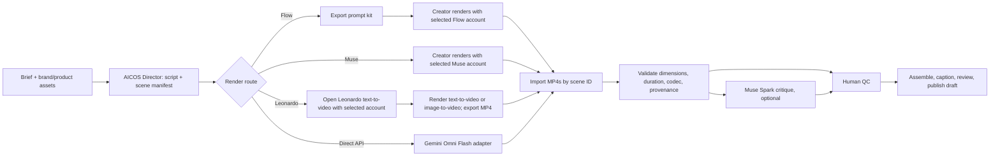

# Google Flow + Muse + Leonardo in video production

**Status:** integration design; render in Flow or Muse account, then import exported clips into Studio.

## Product assumption

The repository's Muse account points to `muse.ai`, Meta's Muse product. The old
adapter guessed `https://muse.ai/api/videos`; that is not a verified generation
contract. Do not send account cookies or production media to it. Use the signed-in
account's web experience when video creation is available, then import its
exported clip. Keep account identity explicit in every handoff. Muse Spark on
Meta Model API is a separate service and must use its own API credentials.

## Roles

| System | Production role | Current integration boundary |
|---|---|---|
| AI Creator OS | Job state, storyboard, assets, assembly, quality checks, approval, publishing | SQLite `studio.db`, `/studio`, FFmpeg |
| Google Flow | Generate selected shots from prompts and keyframes | Web app; use manual handoff and import exported MP4s. Do not label Gemini API calls as Flow calls. |
| Muse AI (`muse.ai`) | Render selected shots when the account has video access | Use account-specific web session and manual export/import. No verified generation API is wired in AICOS. |
| Leonardo.Ai | Text-to-video or image-to-video for selected shots | Open the official generator, choose the intended account/model, check the displayed token cost, download MP4, then upload it to AICOS. No Leonardo generation API or browser automation is wired in AICOS. |
| Muse Spark (optional) | Suggest script/storyboard edits or critique imported clips | Separate Meta Model API integration; video input can produce text critique, not generated video. Keep its API key outside Muse web-account pool. |
| Gemini Omni Flash | Direct programmatic generation and iterative edit | Current stable Gemini API model for text/image-to-video and video edits. |

Google Flow credit balances and model access vary by account tier, region, and
current product rules. Read displayed availability from the user’s Flow account;
do not hard-code a monthly free-credit promise.

## Production flow

1. Create one Studio job and canonical scene manifest. Each scene has stable
   `scene_id`, prompt, aspect ratio, duration, keyframe paths, and preferred
   provider. Keep product claims and brand rules attached to the job.
2. Muse Spark may suggest script/storyboard edits before rendering. After
   import, it may critique clips for continuity, product visibility, and prompt
   adherence. Its response is advice; human QC remains final.
3. For Flow, export a prompt kit containing the manifest and keyframes. Creator
   renders in Flow, then imports one MP4 per `scene_id`. Flow account cookies
   stay in the browser and are not replayed by AICOS.
4. For Muse AI, open the pinned account's Muse profile, render when that
   account has video access, then import one MP4 per `scene_id`. Do not
   automate private UI endpoints.
5. For Leonardo.Ai, open `https://leonardo.ai/text-to-video` in the intended
   account/profile, use the scene prompt (or add a keyframe for image-to-video),
   review the token cost displayed for the selected model, render, download the
   MP4, and import it through the Leonardo tab in Web AI Hub. Free accounts get
   150 daily tokens, but video costs vary by model and settings; the UI is the
   source of truth. The uploaded job records `source=leonardo_ai` and the
   optional account label.
6. Direct API generation uses a provider adapter with explicit model, cost
   estimate, timeout, operation ID, and retry policy. Do not silently switch a
   user-selected provider or retry a paid generation twice.
7. Validate imported/generated files before assembly. Persist provider name,
   model/version, operation ID, prompt hash, source file hash, duration,
   resolution, aspect ratio, and estimated/actual spend with each asset.
8. Assemble only validated clips. Show source and provider on the job detail
   page; require creator approval before publishing.

## Multiple accounts per provider

Keep separate account pools for Google Flow, Muse, and Leonardo web accounts.
The Leonardo import currently stores a user-entered account label on each job;
it does not manage Leonardo sessions or rotate accounts. Keep Muse Spark API
credentials in a separate provider configuration. Never share one account's
session or quota across providers.

1. Pin one account to a video job before rendering. Prefer a healthy account
   with enough remaining quota and lowest recent workload; use round-robin only
   to break ties. Reuse that account for all scenes in the job where possible,
   so one project does not silently mix account-specific model access or
   settings.
2. Store account ID on every handoff and clip asset. For manual Flow/Muse work,
   show which account/profile to open. Keep each browser profile isolated; do
   not copy cookies into provider HTTP requests.
3. Reserve estimated quota at assignment, then reconcile against provider
   usage after generation. Flow balances and credit rates can vary, so capture
   the value from the account or user at runtime; never assign a fixed
   `credits per scene` estimate.
4. If provider confirms a failed request was not charged, mark that account
   unhealthy/cooling down and allow explicit reassignment. If request status or
   charge is unknown, check the provider job before retrying; do not risk a
   duplicate charge.
5. Track per-account state: active/disabled, session health, tier/region,
   remaining quota, reset time, cooldown, recent jobs, and last reconciliation.
   UI should show pool totals and account-level status without revealing
   credentials.

The existing `webai.Store.PickActiveAccount` chooses the least-used eligible
account and tracks request counts/cooldowns. It does not persist credit balances,
reserve quota, or pin one account to a whole Studio job. Add those pieces before
automating account rotation for real video generation.

## Changes needed before claiming end-to-end support

1. Add a `VideoProvider` contract with capabilities (`text_to_video`,
   `image_to_video`, `video_edit`, `manual_handoff`) and explicit result metadata.
2. Implement Flow prompt-kit export and a Studio upload/import endpoint that
   maps files to scene IDs. Add resumable partial import and duplicate detection.
3. Add per-provider account selection, job pinning, quota reservation, and
   usage reconciliation. Extend the current account store; do not rotate on an
   ambiguous timeout.
4. Replace the guessed `muse.ai/api/videos` request with a documented Muse
   generation API if one becomes available; until then keep manual
   Muse-account handoff and clip import.
5. Move direct Google generation to a supported stable model. Google’s current
   Gemini API guide says Veo 3.1 Preview shuts down **2026-10-22** and recommends
   Gemini Omni Flash or GA models on Gemini Enterprise Agent Platform. Do not
   treat Google Flow and Gemini API as the same provider.
6. Add provider health and capability UI. Label connected account, manual step,
   expected credits/cost, and unsupported capability accurately.

## Test plan

- Unit: manifest serialization, stable scene IDs, prompt-kit contents, file
  validation, duplicate import rejection, and provider metadata persistence.
- Contract: fake Flow/Muse manual imports and fake direct-generation adapter;
  assert one generation call per scene and no credentials in logs.
- App smoke: fresh data directory, health route, Studio job list, import route.
- Live provider run: separate opt-in after account, region, and cost are
  confirmed. Never run live generation as part of ordinary tests.

## Official references

- [Google Flow](https://labs.google/fx/tools/flow) — current product, access,
  and credits vary by plan and region.
- [Leonardo.Ai Text to Video](https://leonardo.ai/text-to-video) — text-to-video
  and image-to-video product page; free daily token amount is shown there.
- [Leonardo.Ai video generation help](https://intercom.help/leonardo-ai/en/articles/11027827-generating-video-on-leonardo-ai)
  — supported video workflow, model limits, and per-generation token display.
- [Generate and edit videos with Gemini Omni Flash](https://ai.google.dev/gemini-api/docs/omni)
  — direct programmatic video generation/editing API.
- [Veo API guide](https://ai.google.dev/gemini-api/docs/veo) — Veo capabilities
  and current preview deprecation notice.
- [Meta Model API model catalog](https://dev.meta.ai/docs/models) — Muse Spark
  and other official model input/output capabilities.
- [Meta announcement: Muse Image and Muse Video](https://ai.meta.com/blog/introducing-muse-image-muse-video-msl/)
  — Muse Video availability statement.
