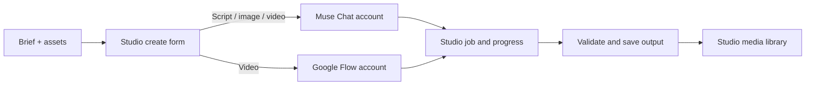

# Muse Chat and Google Flow video integrations

## Production flow

A user selects a connected account, writes a prompt, and submits one Studio job. Output files are downloaded into the Studio media directory and exposed through the job detail/library UI. Provider usage and account credits remain visible in the provider account; AICOS does not claim a fixed free allowance.

## Muse Chat

`internal/webai/muse_gateway.go` currently implements Muse's first-party auth/session/Hatch sequence and its Noise WebSocket transport. It sends `chat.stream`, polls `chat.history`, and extracts signed Muse media links. The adapter performs no API-key based Muse call.

If direct requests fail before the prompt can be sent, `internal/webai/muse_headless.go` starts installed Chrome/Edge in headless mode, restores the saved Muse cookies, and submits the request through Muse's page. No visible generation window opens. If the direct request may have reached Muse, the job is failed without a second submission to avoid duplicate generation.

The user-provided [Muse-Chat-MCP](https://github.com/duclm1x1/Muse-Chat-MCP) project shows browser-based chat interaction. The [muse-cli protocol notes](https://github.com/nikships/muse-cli/blob/main/docs/PROTOCOL.md) and [gateway source](https://github.com/nikships/muse-cli/blob/main/src/muse_cli/gateway.py) served as references for the internal Hatch/Noise protocol. These private interfaces may change without notice.

## Google Flow

`internal/webai/flow_api.go` uses the saved Google session cookie with observed Flow web-client calls to create a project, submit video generation, poll authenticated project history, resolve media URI, and download MP4. The implementation is based on the [Flow API sample](https://github.com/396001000/flow-Gemini-api/blob/main/flow_api.py); it does not use an AI Studio developer key. Flow access, model availability, credits, and output vary by account and region.

## Failure handling

- Account selection skips inactive, expired, invalid, and disconnected sessions.
- Flow/Muse output URLs must match provider host allowlists. Downloaded media must pass file-signature checks.
- A request timeout after possible provider submission is not retried automatically.
- Provider sessions, project IDs, media IDs, and failures are recorded as job metadata/progress; cookie and access-token values are not written to logs.
- Provider calls are excluded from ordinary tests. Current environment could not resolve external provider hosts, so direct account generation still needs an opt-in live run.
