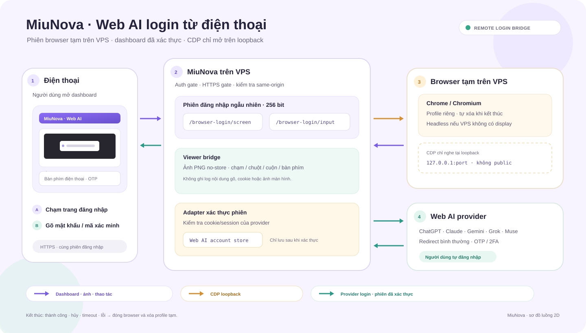

# Remote Web AI Login

> **Trạng thái: đã nối trong source; cần xác minh trên VPS bằng điện thoại và
> provider credentials thật.** Build kiểm tra được; live login chưa chạy.
> Xem [IMPLEMENTATION_STATUS](../IMPLEMENTATION_STATUS.md).

## Mục tiêu

Cho phép chủ app đăng nhập Web AI bằng điện thoại trong khi MiuNova chạy trên
VPS. Yêu cầu này nói về nút đăng nhập account AI web, không phải form `/login`
của dashboard.

## Luồng hiện tại

1. Điện thoại mở dashboard đã xác thực và bắt đầu một phiên login.
2. Server tạo profile tạm, riêng cho phiên. Linux không có `DISPLAY` hoặc
   `WAYLAND_DISPLAY` chạy Chrome/Chromium headless; máy desktop vẫn mở browser
   bình thường.
3. Modal lấy screenshot không cache qua `/web-ai/browser-login/screen`.
   Route input cùng origin gửi thao tác chạm, chuột, cuộn, chữ và phím thường
   dùng qua CDP. Trên điện thoại, chạm field trong ảnh rồi gõ qua ô bàn phím
   phía dưới; OTP/2FA vẫn do provider xử lý.
4. Adapter hiện có kiểm tra cookie/session và lưu qua
   `WebAI.UpsertAccountSession`.
5. Thành công, hủy, timeout hoặc lỗi sẽ đóng browser và xóa profile tạm.

## Ranh giới và bảo vệ

- Không nhúng trang provider bằng iframe; CSP/frame policy có thể chặn.
- CDP chỉ bind `127.0.0.1`; không trả port hoặc WebSocket URL về điện thoại.
- Các route remote yêu cầu dashboard auth. Session ID có 256 bit entropy; thao
  tác ghi qua origin gate; remote login yêu cầu HTTPS. Proxy kết thúc TLS cần
  gửi `X-Forwarded-Proto: https`.
- Screenshot trả `no-store`. Không ghi log chữ đã nhập, mật khẩu, cookie, ảnh
  hoặc browser storage. Profile cô lập, xóa khi phiên kết thúc.
- Xác thực cookie tiếp tục nằm trong adapter riêng từng provider.

## Yêu cầu chạy

App host cần Chrome, Edge hoặc Chromium được hỗ trợ. VPS Linux headless không
cần Xvfb, VNC, noVNC hoặc Playwright. Điện thoại cần mở dashboard qua HTTPS và
đăng nhập dashboard như thường lệ.

## Tiêu chí nghiệm thu

- Chạy app trên VPS không màn hình; mở Web AI từ điện thoại.
- Bấm Đăng nhập; thấy trang provider trong modal; hoàn tất login, redirect,
  OTP và 2FA.
- Phiên được adapter xác thực và lưu đúng một lần; hủy/timeout đóng browser và
  xóa profile.
- Request không có dashboard auth không xem/điều khiển được browser; CDP không
  truy cập được từ ngoài VPS.

Các bước nghiệm thu VPS/điện thoại/provider thật hiện chưa chạy.

## Ngoài phạm vi

- Tự nhập credential provider hoặc vượt challenge.
- Tái sử dụng profile browser cá nhân.
- Thay thế OAuth chính thức cho tích hợp xuất bản social.
